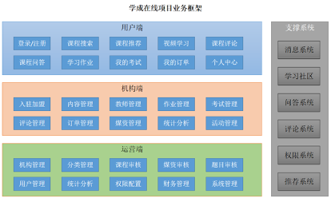
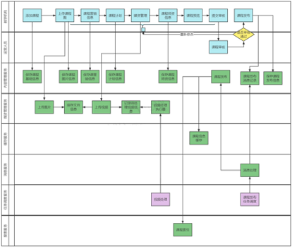
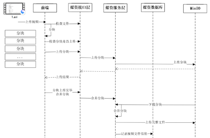
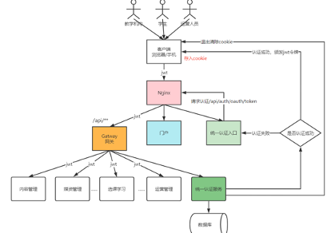
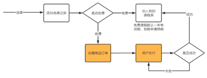
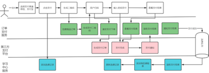
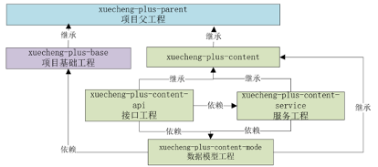
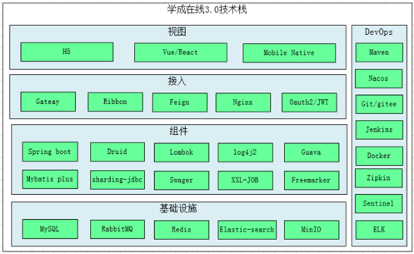
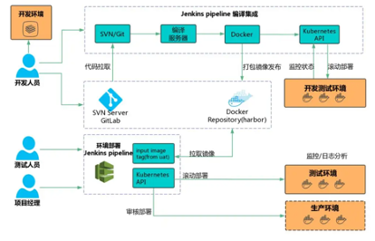
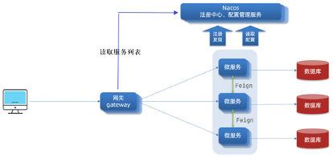

# xuecheng-plus-project


## 学成在线微服务项目

### 项目说明
```
├── api-test                   // api-test模块
├── doc                        // 项目各个章节文档
├── spl                        // 项目用到的数据库sql文件
├── static                     // 静态资源
├── xuecheng-plus-auth         // 认证授权模块
├── xuecheng-plus-base         // 项目配置/声明
├── xuecheng-plus-checkcode    // 验证码模块
├── xuecheng-plus-content      // 课程内容模块
├── xuecheng-plus-gateway      // 网关模块
├── xuecheng-plus-generator    // mybatis-plus generator生成器
├── xuecheng-plus-learning     // 选课学习模块
├── xuecheng-plus-media        // 媒资模块
├── xuecheng-plus-message-sdk  // 消息模块
├── xuecheng-plus-orders       // 订单支付模块
├── xuecheng-plus-parent       // 项目父工程
├── xuecheng-plus-search       // 搜索模块
└── xuecheng-plus-system       // 基础属性定义
```

### 环境要求

| 组件 | 版本建议 | 说明 |
| --- | --- | --- |
| JDK | **17**（LTS） | 父工程已按 `release 17` 编译；不支持再使用 JDK 8 直接构建当前分支 |
| Maven | 3.8+ | 从 `xuecheng-plus-parent` 聚合构建 |
| Nacos | 2.x（与 SCA 2021.0.x 兼容） | 服务发现与配置中心；各服务 `bootstrap.yml` 中的 `server-addr` / `namespace` 需改成你的环境 |
| MySQL | 8.0+ | 初始化脚本见 `spl/` |
| Redis | 6.x/7.x | 验证码、缓存等 |
| RabbitMQ | 3.x | 订单/学习通知 |
| MinIO | 与客户端 8.5.x 兼容 | 媒资存储 |
| Elasticsearch | **7.17.x**（与客户端一致） | 搜索模块；RHLC 客户端已绑定 7.17.21 |
| XXL-JOB | 2.4.x | 分布式任务（内容发布、视频处理等） |

> 说明：本仓库仍使用 **Spring Boot 2.7 / javax** 命名空间，**未**迁移到 Spring Boot 3（Jakarta）。若后续要上 Boot 3，需单独评估 OAuth2 旧 API、Swagger、MyBatis-Plus 等改造量。

### 构建

```bash
# 使用 JDK 17
export JAVA_HOME=/path/to/jdk-17
export PATH="$JAVA_HOME/bin:$PATH"

# 在仓库根目录，通过父工程打包全部业务模块（跳过测试）
mvn -q -DskipTests -f xuecheng-plus-parent/pom.xml package
```

可选：`xuecheng-plus-generator` 不在父工程 modules 中，需要时可单独进入该目录构建。

### 运行步骤（本地）

1. **准备中间件**：启动 Nacos、MySQL、Redis，以及按需启动 RabbitMQ、MinIO、Elasticsearch、XXL-JOB Admin。
2. **导入数据库**：执行 `spl/` 下对应 SQL（如 `xcplus_content.sql`、`xcplus_users.sql` 等）。
3. **配置 Nacos**：按课程文档在 Nacos 中创建命名空间/配置（共享配置如 `swagger-*.yaml`、`logging-*.yaml`、`feign-*.yaml` 等）。
4. **修改本地地址**：各服务 `src/main/resources/bootstrap.yml` 中的 `spring.cloud.nacos.server-addr`、`namespace`、`group` 改为你的环境；**不要把真实密钥提交到仓库**。
5. **启动顺序建议**：
   1. `xuecheng-plus-gateway`
   2. `xuecheng-plus-system`（system-api）
   3. `xuecheng-plus-auth` / `xuecheng-plus-checkcode`
   4. `xuecheng-plus-content`、`xuecheng-plus-media`、`xuecheng-plus-search`
   5. `xuecheng-plus-learning`、`xuecheng-plus-orders`
6. IDE 中运行各模块主启动类，或使用 `spring-boot:run` / 已打包的 `java -jar`。

### 测试说明

仓库内现有测试多为依赖本地路径或外部中间件的集成/手工验证用例（如 MinIO、支付宝沙箱、Nacos、本机视频文件）。在无中间件环境下请使用 `-DskipTests` 做编译验证。

### 项目介绍


**内容模块介绍**



**媒资模块介绍**



**认证授权模块介绍**



**选课学习授权模块介绍**



**订单支付授权模块介绍**



### Maven说明


### 技术栈


### 集成说明


### 网关说明


### nginx配置文件

[nginx配置](./static/nginx.conf)

## 说明

1. 现阶段支付宝支付沙箱环境支持在浏览器直接模拟，无需安装沙箱支付宝app。只需要在沙箱账户注册账号即可。

2. 因为项目部署在jenkins侧流水线配置较为复杂，所以项目暂未在服务器实际部署测试。

3. 依赖与 JDK 已做维护性升级（详见相关 PR）：Log4j2 随 Spring Boot 2.7.18 带上已修复版本；`fastjson` 仍为 1.2.83（1.x 末版），长期建议迁 `fastjson2`。
